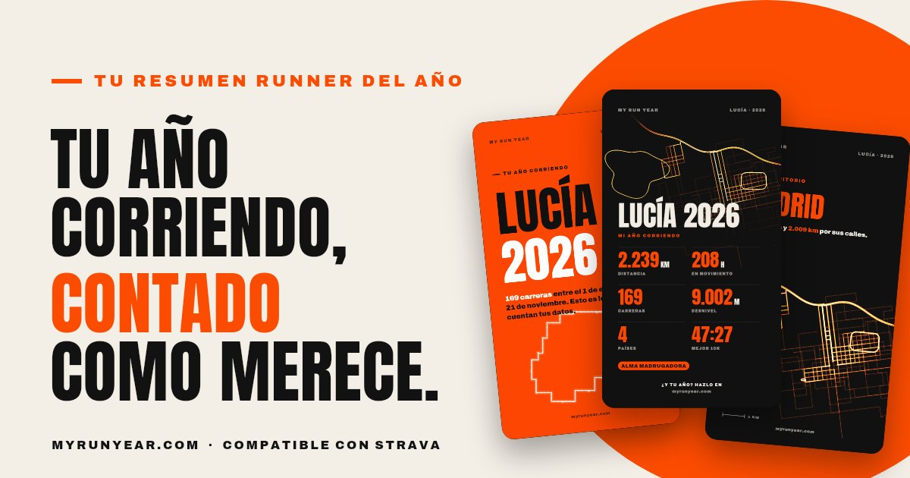

# My Run Year · Tu año corriendo, en una historia



Web ([myrunyear.com](https://myrunyear.com/)) para crear tu **resumen anual de running** a partir del
archivo que te da Strava. Kilómetros, horas, desnivel, rachas, mejores marcas, pulsaciones, zapatillas, países,
mapa de calor de tu ciudad, tu perfil runner… en hasta 20 pantallas animadas listas para
compartir en Instagram (imagen o vídeo).

- **100 % en el navegador**: el archivo no se sube a ningún servidor. Sin registro ni login.
- **Funciona en ordenador y en móvil** (Android e iPhone), en el navegador: sin app que instalar.
- **Cualquier idioma de Strava**: el export viene traducido (cabeceras y fechas) y se detecta solo.
- **Exports enormes**: solo se leen las partes necesarias del `.zip`, aunque pese varios GB.
- **12 idiomas** (web y tarjetas): español, catalán, inglés, francés, alemán, italiano, portugués,
  neerlandés, ruso, chino, japonés y coreano. Kilómetros o millas.
- **Hecha para compartirse**: cada idioma tiene su página (`/es/`, `/en/`, `/ca/`…) con su vista
  previa traducida para WhatsApp, Instagram o X; las imágenes llevan la marca de agua con la web y
  la última tarjeta invita a hacerse el suyo; al compartir se añade el enlace.

## Cómo funciona (para quien la usa)

1. En **strava.com** → tu foto → Configuración → Mi cuenta → *Descarga tu cuenta* → Comenzar →
   **Solicitar descarga** (no borra nada; una vez por semana).
2. Strava envía por email un enlace al `export_XXXXXXXX.zip` (minutos u horas).
3. Se suelta el `.zip` en la web (o la carpeta, si el móvil lo descomprimió) y listo.

## Qué hay por dentro

| Pieza | Dónde |
| --- | --- |
| Lectura del export: zip con acceso aleatorio, CSV en cualquier idioma, fechas, FIT/GPX/TCX | `src/parse/` |
| Procesado en paralelo con Web Workers (con alternativa sin workers) | `src/worker/`, `src/app/` |
| Países, ciudades y zona horaria sin conexión | `src/geo/`, `public/data/` |
| Estadísticas del año, equivalencias y perfil runner | `src/stats/` |
| Tarjetas animadas en canvas a 1080×1920 | `src/render/` |
| Web: portada, flujo, visor tipo stories, compartir (PNG, MP4, zip) | `src/ui/`, `index.html` |
| Atleta de demostración (datos inventados) | `src/demo/` |
| Textos de la web y de las tarjetas en 12 idiomas | `src/i18n/site/`, `src/i18n/cards/` |
| Páginas de cada idioma, sitemap, robots y 404 (al compilar) | `scripts/site-pages.ts` |

Detalles del export que conviene saber (comprobados con exports reales):

- `activities.csv` viene **en el idioma de la cuenta** (`Fecha de la actividad`, `Aktivitätsdatum`…),
  y a veces con cabeceras sin traducir envueltas en HTML. Las columnas van siempre en el mismo
  orden, así que se leen por posición; algunas columnas nuevas se buscan por nombre.
- La fecha está en **UTC** y con formato local (`9 sept. 2018 17:26:30`, `2 ago 2026, 12:20:32 p. m.`,
  `16.10.2024, 15:57:17`…). La hora local se calcula con la posición GPS.
- Las rutas están en `activities/` como `.fit.gz`, `.gpx`, `.gpx.gz` o `.tcx.gz`.

## Desarrollo

Requisitos: Node 20 o superior.

```bash
npm install
npm run dev          # http://localhost:5173
```

- `http://localhost:5173/dev.html` muestra todas las tarjetas con la demo
  (`?card=distance&t=1200`, `?lang=ru&units=imperial`, `?play`, casos extremos con
  `?case=ultra|tiny|nogps|longname|partial|down`).
- `npm run og` regenera las imágenes de vista previa al compartir el enlace (`public/og-xx.jpg`, una
  por idioma) y comprueba que ningún texto pise a otro, a las tarjetas o al círculo.
- `npm run sample` genera `samples/export_12345678.zip` (export de prueba realista) y
  `http://localhost:5173/?sample` lo carga para probar el flujo completo.
- `npm test` (Vitest) · `npm run typecheck` · `npm run build` (sale en `dist/`).
- `npm run check:web` compila y revisa la web en los 12 idiomas, en móvil y en ordenador, con el
  Chrome o Edge del sistema en modo invisible: textos que se salen, botones partidos, scroll
  lateral, errores de JavaScript… y el recorrido completo con el export de prueba. Capturas en
  `samples/web-check/`.
- `npm run sim -- --n=300` (simulador de atletas, ver `CLAUDE.md`); `--langs=all` dibuja cada
  atleta en los 12 idiomas.
- `npm run fonts` regenera las tipografías de titulares en cirílico y CJK (`src/styles/fonts/`).
- `npm run geodata` regenera `public/data` (necesita `scripts/cities15000.zip` de
  [GeoNames](https://download.geonames.org/export/dump/cities15000.zip)).
- `npx tsx scripts/validate-fit.ts <carpeta>` compara el lector FIT con el SDK oficial de Garmin.

## Publicar la web

Es una web estática: el resultado de `npm run build` (carpeta `dist/`) se puede subir a
cualquier hosting. Cada `git push` a `main` pasa los tests y genera el build en GitHub Actions.

### Opción A · GitHub Pages (gratis, ya preparado)

1. En GitHub: **Settings → Pages → Build and deployment → Source: GitHub Actions**.
2. **Settings → Secrets and variables → Actions → Variables → New variable**:
   `DEPLOY_PAGES` = `true`.
3. Haz un push (o lanza el workflow a mano). Quedará en
   `https://alexxberrocal.github.io/strava-wrapped/`.

La URL pública (enlaces al compartir, vista previa y sitemap) se fija al compilar con
`VITE_SITE_URL`: en GitHub Actions es la variable `SITE_URL` del repositorio o, si no existe, la
de GitHub Pages.

### Opción B · Vercel, Netlify o Cloudflare Pages (gratis)

Importa el repositorio desde su web con **Build command** `npm run build` y
**Output directory** `dist`. Se vuelve a publicar solo en cada push.

### Dominio propio

1. Cómpralo (unos 10–15 €/año) en Cloudflare Registrar, Porkbun o Namecheap. **Evita la
   palabra "strava"** en el dominio (es su marca).
2. Añádelo en el hosting (GitHub Pages: *Settings → Pages → Custom domain*; Vercel/Netlify:
   *Domains*) y crea en tu proveedor el registro DNS que te indiquen (normalmente un `CNAME`).
   El HTTPS es automático.
3. Cambia `BRAND.domain` en `src/config.ts` (marca de agua de las imágenes y vídeos) y crea la
   variable `SITE_URL` del repositorio (por ejemplo `https://runrecap.app/`).

## Personalizar

- Nombre y dominio: `src/config.ts`.
- Colores: `src/render/kit.ts` (tarjetas) y `src/styles/main.css` (web).
- Textos: `src/i18n/site/<idioma>.ts` (web) y `src/i18n/cards/<idioma>.ts` (tarjetas). El
  español define las claves; los tests comprueban que los 12 idiomas las tengan todas, con las
  mismas variables.

## Monetizar sin molestar (ideas, de menos a más intrusivo)

1. **Botón de apoyo** (Ko-fi, Buy Me a Coffee) en la pantalla de resultados.
2. **Enlaces de afiliado** útiles: por ejemplo, en la tarjeta de zapatillas, "¿repetirías?"
   con enlace al modelo (Amazon Afiliados, tiendas de running).
3. **Patrocinio** de una marca o carrera popular (una pantalla patrocinada, con su logo).
4. **Anuncios** (Google AdSense, EthicalAds…) solo en la portada, nunca en la historia ni en
   las imágenes. Hoy la web **no usa cookies ni rastreadores**, así que no necesita banner de
   cookies; con anuncios o analítica de terceros harán falta aviso de cookies y política de
   privacidad (RGPD).

## Aviso legal

- Proyecto independiente: **no está afiliado, patrocinado ni respaldado por Strava, Inc.**
  Strava es una marca registrada de Strava, Inc. Se nombra solo para explicar de dónde sale el
  archivo; no se usan su logotipo ni su nombre en la marca.
- La web no usa la API de Strava: cada persona usa **su propio archivo de datos**, que Strava
  entrega a cualquier usuario (derecho de portabilidad del RGPD).
- Código: © Àlex Berrocal, todos los derechos reservados (ver `LICENSE`). Componentes de
  terceros: `THIRD_PARTY_NOTICES.md`.
